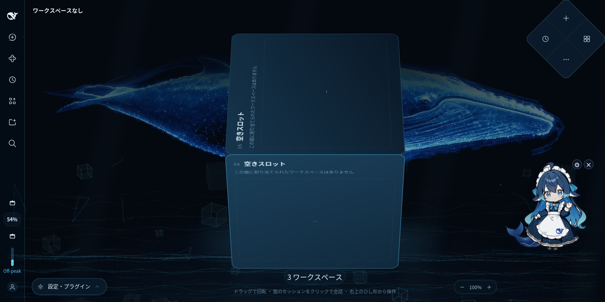

# dsh-cube-ui

DeepSeek Harness（DSH）0.2.2-rc.1 の Web GUI 向けクライアントプラグイン。
メイン列の会話パネルを立方体ステージに置き換え、ワークスペースを立方体の 6 面、
選択中セッションの会話を立方体中央に投影します。

- 1 面 = 1 ワークスペース（7 個以上はページ切り替え）
- 立方体のドラッグで回転。回転中は面の識別情報だけを淡く描画し、離すと最寄りの正面へスナップ
- 右上に 4 分割のひし形ナビ（新規セッション / プラグイン / 自動タスク / その他）
- 左下に折りたたみ式の「設定・プラグイン」ドック。DSH 標準サイドバーは温存し、既定で折りたたみ
- 右下のピルで立方体のサイズを 60〜160% に変更（`localStorage` に保存）
- 既存テーマ（`--dsw-*` トークン）に追従。追加の npm 依存なし（3D は CSS transform のみ）

## スクリーンショット



ワークスペースが未割り当ての面（空きスロット）を正面にした状態を、上から見下ろしたところ。
背景のクジラは別プラグイン「深海の大鯨」テーマによるものです（cube-ui 単体の既定の背景ではありません）。

## リポジトリ構成

| パス | 内容 |
| --- | --- |
| `plugin/` | プラグイン本体（`@local/dsh-cube-ui`、DSH のプロファイルへバンドルとして追加） |
| `plugin/src/` | ビルド前のソース（`client.template.js` と `styles.css`） |
| `plugin/client.js` | ビルド成果物。コミット済みで、インストール時にビルドは不要 |
| `DESIGN.md` | 設計メモ（決定事項・画面仕様・操作仕様） |
| `FEASIBILITY.md` | DSH 0.2.2-rc.1 の拡張点の調査結果 |

`mock/` と `shots/`（モックアップと実機スクリーンショット）はローカル作業用の素材で、
会話内容が写るためこのリポジトリには含めていません。公開用に選別した画像だけ `docs/` に置いています。

## ドキュメント

- [plugin/README.md](plugin/README.md) — 導入手順・ファイル構成・トラブルシュート
- [DESIGN.md](DESIGN.md) — 設計メモ
- [FEASIBILITY.md](FEASIBILITY.md) — 実現可能性調査
- [plugin/API-NOTES.md](plugin/API-NOTES.md) — クライアントプラグイン API の調査メモ（file:line 付き）
- [plugin/BUNDLE-NOTES.md](plugin/BUNDLE-NOTES.md) — バンドル仕様・反映方法・ロールバック手順

## ビルド

`client.js` はコミット済みなので、通常はビルド不要です。ソースを変更したときだけ実行します。

```sh
cd plugin
node build.mjs   # src/client.template.js + src/styles.css + locale/*.json を client.js に畳む
```

依存パッケージはありません（素の Node.js）。成果物は
`window.__ModuleLoader__.load({ id, factory(require) { ... } })` 形式の単一スクリプトです。

## 動作環境

- DSH 0.2.2-rc.1（`engines.dsh: ">=0.2.2-rc.1 <0.3.0"`）
- Web とデスクトップの両方を対象（`dsh.client.platform: "web"`）

## ライセンス

MIT（`plugin/package.json` の `license` に準拠）。
